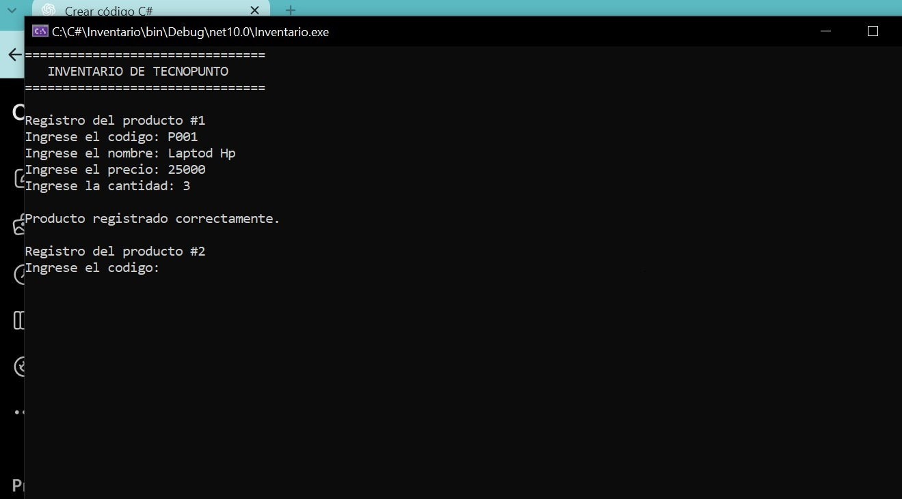
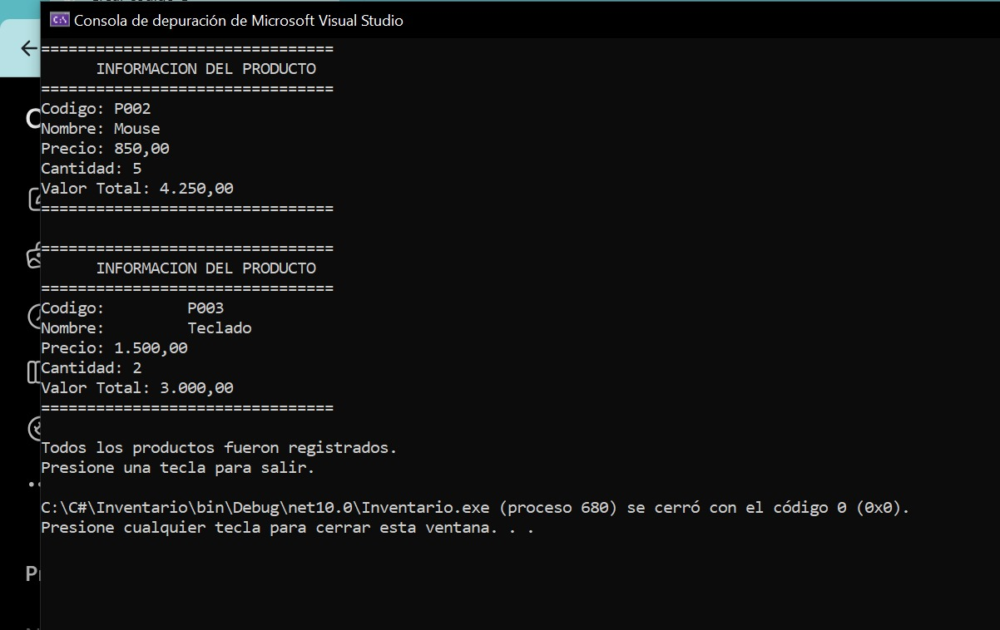
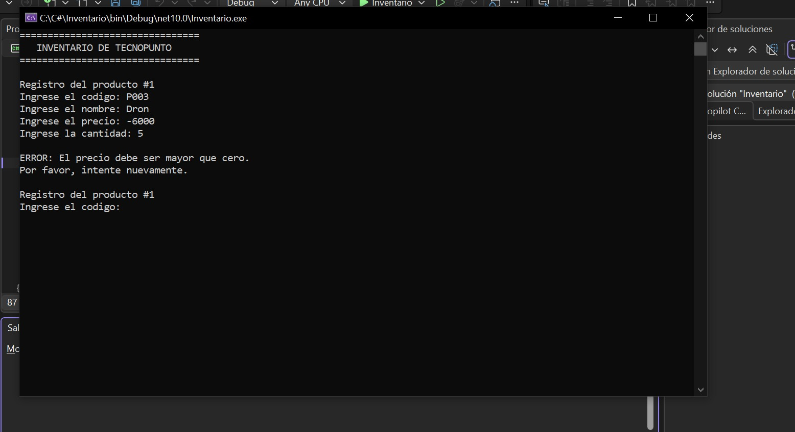
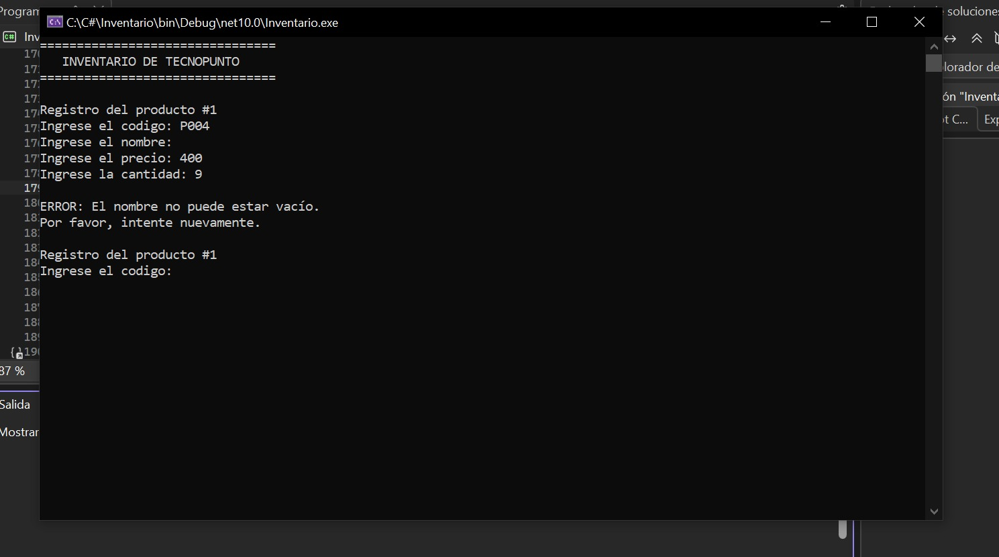
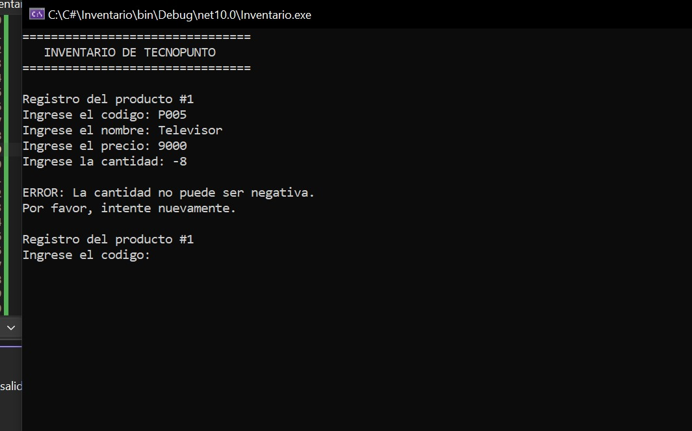
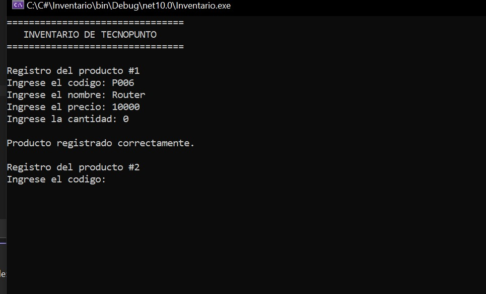

# Control de Inventario - TecnoPunto

## Información general

**Proyecto:** Control de Inventario de TecnoPunto  
**Asignatura:** Programación Básica  
**Actividad:** Clases, objetos y propiedades  
**Docente:** Gamalier Reyes del Carmen  

## Integrantes

- **Albert Alexander Carty** — 2025-2788
- **Orianna Dayanara Calcaño R.** — 2025-2695
- **Maria Pilar Vessania Silvence Yedi** — 2025-3481

## Descripción del proyecto

El proyecto consiste en desarrollar una aplicación de consola en C# para gestionar el inventario de una tienda de tecnología llamada TecnoPunto.

El programa permite registrar tres productos, validar sus datos y calcular el valor total de cada producto según su precio y cantidad disponible.

## Objetivos

- Aplicar los conceptos de clases y objetos en C#.
- Utilizar propiedades para acceder a los atributos de una clase.
- Implementar validaciones para evitar datos incorrectos.
- Registrar productos y calcular el valor total de cada uno.
- Comprender la importancia del encapsulamiento en la programación orientada a objetos.

## Tecnologías utilizadas

- **Lenguaje de programación:** C#.
- **Plataforma:** .NET 10.0.
- **Tipo de aplicación:** Aplicación de consola.
- **Entorno de desarrollo:** Visual Studio.

## Funcionamiento del programa

La aplicación permite:

1. Registrar tres productos.
2. Introducir el código, nombre, precio y cantidad de cada producto.
3. Validar los datos ingresados mediante propiedades.
4. Mostrar mensajes de error cuando se introducen datos no permitidos.
5. Solicitar nuevamente los datos cuando ocurre un error.
6. Calcular el valor total de cada producto mediante la multiplicación del precio por la cantidad.
7. Mostrar la información de los tres productos registrados al finalizar.

## Estructura del proyecto

```text
ControlInventario/
│
├── ControlInventario/
│   ├── CAPTURAS/
│   ├── ControlInventario.csproj
│   └── Program.cs
│
└── README.md
```

## Clases y conceptos utilizados

### Clase Producto

La clase `Producto` representa los artículos que forman parte del inventario. Contiene los campos privados y las propiedades necesarias para almacenar y controlar la información de cada producto.

### Campos privados

- `codigo`: almacena el código del producto.
- `nombre`: almacena el nombre del producto.
- `precio`: almacena el precio del producto.
- `cantidad`: almacena la cantidad disponible.

### Propiedades y validaciones

- **Codigo:** permite establecer y obtener el código del producto.
- **Nombre:** valida que el nombre no esté vacío.
- **Precio:** verifica que el precio sea mayor que cero.
- **Cantidad:** impide que se introduzcan cantidades negativas, pero permite registrar una cantidad igual a cero.
- **ValorTotal:** es una propiedad de solo lectura que calcula el resultado de multiplicar el precio por la cantidad.

### Constructor

Se utiliza un constructor para inicializar los datos de cada producto al momento de crear sus objetos.

### Método MostrarInfo()

Este método muestra en la consola la información de cada producto, incluyendo su código, nombre, precio, cantidad y valor total.

### Clase Program

Contiene el método `Main()`, que inicia la ejecución de la aplicación. También incluye el método `RegistrarProducto()`, encargado de solicitar los datos, crear los objetos y controlar los errores mediante `try-catch`.

### Conceptos aplicados

- Clases y objetos.
- Programación orientada a objetos.
- Encapsulamiento.
- Campos privados.
- Propiedades.
- Constructores.
- Métodos.
- Validaciones.
- Manejo de excepciones (`try-catch`).

## Capturas de la ejecución

### 1. Registro correcto de un producto (P001)

Se registra un producto con todos los datos válidos. El programa muestra el mensaje de registro correcto y continúa con el siguiente producto.



### 2. Información de los productos registrados (P002 y P003)

Se muestran los productos que fueron registrados correctamente, con su código, nombre, precio, cantidad y valor total.



### 3. Precio negativo (P003)

Se ingresa un precio negativo. El programa muestra el mensaje de error correspondiente y vuelve a solicitar los datos.



### 4. Nombre vacío (P004)

Se deja el nombre del producto en blanco. El programa muestra el mensaje de error correspondiente.



### 5. Cantidad negativa (P005)

Se ingresa una cantidad negativa. El programa muestra el mensaje de error y vuelve a solicitar los datos.



### 6. Cantidad cero (P006)

Se ingresa una cantidad igual a 0. El programa acepta el dato, ya que solamente se rechazan las cantidades negativas.



## Requisitos para ejecutar el proyecto

- Tener instalado el SDK de .NET 10.0.
- Contar con Visual Studio compatible con .NET 10 o una terminal.

## ¿Cómo ejecutar el proyecto?

1. Abrir el archivo `Inventario.slnx` en Visual Studio.
2. Esperar a que el proyecto cargue correctamente.
3. Ejecutar la aplicación presionando `F5` o el botón de inicio.
4. Seguir las instrucciones que aparecen en la consola para registrar los tres productos.

También se puede ejecutar desde una terminal ubicada en la carpeta del proyecto utilizando:

```bash
dotnet run
```

## Conclusión

Este proyecto permitió poner en práctica los conocimientos adquiridos sobre programación orientada a objetos en C#, especialmente el uso de clases, objetos, propiedades, constructores y encapsulamiento.

Además, permitió comprender la importancia de implementar validaciones y el manejo de excepciones para garantizar que los datos ingresados sean correctos, facilitando así un control adecuado de la información del inventario.